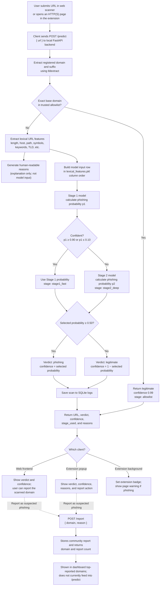

# URL phishing-detection workflow

## Decision details

- The trusted-domain check happens before feature extraction and model inference. It matches the extracted `domain.suffix` string against the allowlist.
- The feature extractor normalizes a trailing slash for feature calculation, then creates lexical signals from the URL. The model uses those feature values in the order saved in `lexical_features.pkl`.
- Stage 1 handles confident predictions. Only uncertain predictions—where the Stage 1 phishing probability is strictly between `0.10` and `0.90`—are sent to Stage 2.
- The final phishing/legitimate cutoff is `0.50`. Confidence is the probability of the returned class.
- Human-readable reasons are generated from URL features for explanation; they do not change the model verdict.
- Users can report a scanned domain from either the web scanner or extension, regardless of the predicted verdict. Successful reports are stored in SQLite and shown in the dashboard's top-reported domains; they do not currently feed into `/predict`.
- The backend currently writes model-path scans to SQLite, but the allowlist branch returns before that logging code.
